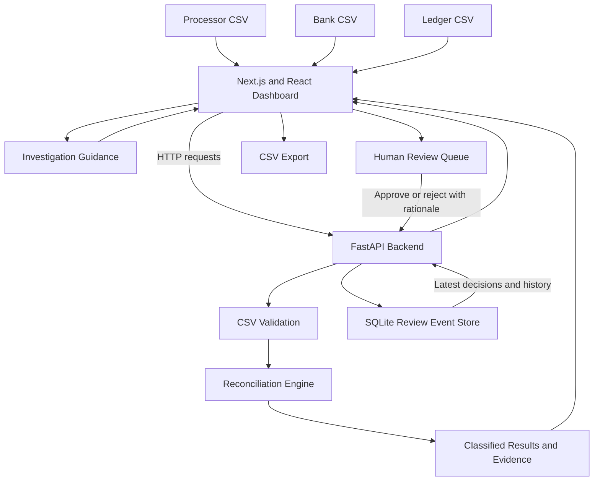

# WaterAid Donation Reconciliation Assistant

## Architecture and Data-Flow Document

**Project:** Hackathon prototype  
**Data:** Synthetic records only  
**Status:** Local development application  
**Version:** 1.0

## 1. Purpose

The WaterAid Donation Reconciliation Assistant compares donation-related records from a payment processor, bank statement, and accounting ledger. It classifies potential matches and discrepancies, presents supporting evidence, guides investigation, and records human review decisions.

The system assists financial review. It does not move money, post accounting entries, issue tax receipts, or connect to WaterAid's production financial systems.

## 2. Architecture Diagram

The diagram represents the application's logical workflow. CSV upload and review requests use the FastAPI backend. Uploaded source files and SQLite review history are stored separately.

## 3. Technology Components

| Component | Technology | Responsibility |
|---|---|---|
| User interface | Next.js, React, TypeScript | Upload files, show results, support investigation and review |
| Styling | Tailwind CSS | Dashboard layout and presentation |
| API | FastAPI | Validate requests, process uploads, return results and record reviews |
| Reconciliation logic | Python | Compare records and classify potential matches and exceptions |
| Source-file storage | Local filesystem | Store uploaded CSVs under UUID-based run directories |
| Review persistence | SQLite | Store reviewer decisions and append-only review events |
| Investigation guidance | Python rules-based guidance and optional OpenAI integration | Explain potential causes and suggest investigation steps |
| Data exchange | CSV, JSON, HTTP | Transfer source records, results and review decisions |
| Validation | pytest and Python scripts | Test logic, source totals and expected synthetic outcomes |

## 4. Data Flow

### Step 1 — Import source files

The user provides three CSV files:

- Processor transactions
- Bank deposits
- General-ledger entries

Each upload is validated for a CSV file extension, non-empty content, UTF-8 encoding, required columns and data rows. Each file is limited to 5 MB.

### Step 2 — Store the uploaded run

Uploaded files are stored beneath:

`data/uploads/<run-uuid>/`

The application uses a UUID-based run identifier to locate the corresponding source files. Uploaded files are separate from the SQLite review database.

### Step 3 — Reconcile records

The Python reconciliation engine processes the processor, bank and ledger files. It classifies potential matches and exceptions using implemented rules.

Examples include:

- Exact amount matches
- Fee-adjusted settlements
- Missing bank records
- Amount mismatches
- Duplicate processor records
- Donations with partial refunds
- Ambiguous bank candidates

The output depends on the supplied data and implemented rules. A classification is a proposal for review, not proof that a financial transaction is correct.

### Step 4 — Present evidence

The dashboard displays reconciliation items and their available supporting source records. It also presents source totals, investigation guidance, and review status.

Scores and explanations are advisory. They must not replace source evidence or professional judgement.

### Step 5 — Investigate exceptions

The reviewer examines the evidence and follows the suggested investigation checks. Missing or ambiguous records remain unresolved until reviewed.

### Step 6 — Record the human decision

The reviewer supplies an identifier, chooses approval or rejection, and enters a rationale.

The backend validates the review request and writes a review event to SQLite. The event includes the run ID, item index, reviewer ID, decision, rationale and timestamp.

Review history is stored in:

`backend/reconciliation.db`

The application derives the latest decision for an item from its ordered review events. Earlier events remain in the history when another decision is recorded.

### Step 7 — Export the report

The dashboard can export a CSV report containing reconciliation findings, financial summary information, review statuses and available reviewer details.

The export supports further review and documentation. It does not post entries to an accounting system.

## 5. Storage and Traceability

| Data | Location | Purpose |
|---|---|---|
| Uploaded source files | `data/uploads/<run-uuid>/` | Retain source CSV files for a reconciliation run |
| Review history | `backend/reconciliation.db` | Persist reviewer decisions and historical events |
| Synthetic demonstration files | `data/synthetic/` | Supply repeatable test and demo inputs |
| Expected results | `data/expected/answer_key.json` | Define expected outcomes for evaluation |
| Validation scripts | `scripts/` | Check source totals and reconciliation outcomes |

The prototype uses local filesystem and SQLite storage. It is not a production audit platform and does not provide a complete enterprise-grade access-control, backup, retention or monitoring solution.

## 6. Human-in-the-Loop Controls

- Reconciliation results require human review.
- Reviewers can approve or reject items.
- Review decisions require a reviewer identifier and rationale.
- Review events are timestamped.
- Earlier review events remain available in the audit history.
- Unmatched and ambiguous records are surfaced for investigation.
- The prototype does not autonomously move money or post accounting entries.

These controls reduce the risk of treating an uncertain match as a confirmed financial result. Reviewers must still verify the source evidence.

## 7. AI and Rules-Based Guidance

The reconciliation engine uses implemented rules to classify records. The investigation assistant provides supporting guidance through implemented logic and an optional OpenAI integration.

Live OpenAI operation has not been verified for the current demonstration environment. The project should be demonstrated using its rules-based fallback unless the live integration is independently tested.

AI-generated guidance is advisory and must not be treated as independent financial verification.

## 8. Validation Evidence

The latest recorded validation results for the synthetic dataset are:

- Backend tests: 31 passed.
- Source financial integrity: 7 of 7 checks passed.
- Reconciliation evaluation: 8 of 8 expected cases passed.
- Actual reconciliation items: 10, including two unreferenced bank exceptions.

The evaluation measures agreement with eight predefined synthetic cases. It does not establish accuracy on unseen records or production financial data.

## 9. Security and Scope

The prototype is intended for local development and demonstration using synthetic data only.

It is not connected to WaterAid production systems. It does not provide verified production-grade authentication, role-based permissions, secure deployment, or enterprise data governance.

Do not upload real donor information, payment-card details, credentials or confidential financial records.

## 10. Potential Future Integration

A future implementation could be assessed for integration with WaterAid's Microsoft ecosystem and approved finance workflows. Such integration would require authorization, security review, access controls, data-retention decisions, operational monitoring and testing against approved data.

No Microsoft or production finance integration is claimed to exist in this prototype.